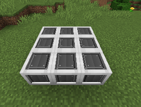
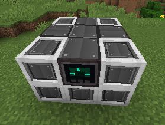
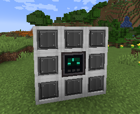

# Nova Reactor

[Português](../pt/reactor.md)

The Nova Reactor converts Blackholes into heat, then converts stored heat into FE. Fuel columns, coolant contact, circulation, temperature and waste management determine its output. There is no calibration requirement or calibration output penalty.

## Compact 3×3×3 reactor

The original compact reactor remains supported. Build a casing shell around one **Nova Reactor Core**, placed at the exact center. Replace non-edge face positions with one **Controller** and the required **Item Ports**, **Energy Ports** or **Waste Fluid Ports**. Their positions can be exchanged; additional ports share the same reservoirs. Corners and edges remain **Nova Reactor Casing**.

```text
Top / bottom       Middle, example
C C C              C E C
C C C              I R I
C C C              C T C

C = Nova Reactor Casing     R = Reactor Core
T = Controller         E = Energy Port
I = Item Port
```





The compact version has integrated fuel/control/cooling behavior: the Core occupies its only interior position. Its nominal peak is **16 MFE/t**, and its energy buffer holds **10 GFE**.

## Larger reactors

Build an **odd cubic shell**, such as 5×5×5, 7×7×7, 13×13×13, 17×17×17 or larger. There is no mod-defined maximum dimension; the entire cube must fit within the world's build height.

1. Fill the exterior shell with **Nova Reactor Casing** and place exactly one **Nova Reactor Core** at the cube's center.
2. Replace a non-edge exterior face position with the **Controller**. Controllers and ports can occupy side walls, the roof or the floor, excluding edges and corners.
3. Inside, build separated vertical **Nova Fuel Rod** columns. Each column must span every interior layer from the floor to the roof. Do not use the central Core's horizontal column, and do not place fuel columns directly side by side.
4. Replace the roof casing directly above each fuel column with one **Nova Control Rod**. Every fuel column needs its own roof control; unused roof controls invalidate the layout.
5. Fill every remaining interior position with **Nova Coolant Channels**, except the central Core. Empty interior gaps invalidate a modern modular reactor.
6. Add input-mode **Item Ports** for fuel, coolant and circulation, output-mode Item Ports for internal waste processing, and enough **Energy Ports** and cables to export the output.

Each input Item Port supplies up to eight cooling-capacity units. Local fuel/coolant contact and nearby coolant distribution matter: distant coolant volume does not guarantee effective cooling. More fuel columns require more coolant circulation and fuel supply.

The Controller validates large structures over several ticks. The Structure page shows progress and distinguishes validation, invalid construction and unloaded chunks. All required chunks must remain loaded naturally for operation; the reactor does not force-load them. Resources remain stored while a required chunk is unavailable.

## Output and storage

The historic buffer benchmarks remain:

| External size | Storage units | FE buffer |
|---|---:|---:|
| 3 | 1 | 10 GFE |
| 5 | 3 | 30 GFE |
| 7 | 7 | 70 GFE |
| 9 | 14 | 140 GFE |
| 11 | 25 | 250 GFE |
| 13 | 40 | 400 GFE |

Above size 13, storage units scale with useful interior volume: `round(40 × (size − 2)³ / 1331)`. Each storage unit holds **10 GFE**, **1,000,000 fuel units**, **1,000,000 coolant units**, and **100,000 mB of waste**. Stored contents are retained if a smaller valid shell reduces capacity; insertion resumes after the excess is removed or consumed.

For sizes through 13, each complete controlled fuel column contributes **16 MFE/t** of nominal power. Above that benchmark, nominal power scales with actual active fuel segments at **16/11 MFE/t per segment**. All valid modern columns participate; the Core does not impose the old fixed column limit.

Configured power scales active fuel, fuel consumption and waste production together. Actual FE output also depends on casing temperature, spatial cooling efficiency, waste occupancy and residual heat. Extra shell volume increases potential storage and building space; it does not grant a free output multiplier. Each connected Energy Port can export through its cable/receiver's throughput, drawing from one shared FE balance.

## Fuel, coolant and waste

| Resource | Function | Value |
|---|---|---:|
| Blackhole | Fuel, supplied through input Item Ports | 10,000 fuel units/item |
| Nova Bar | Coolant, supplied through input Item Ports | 5,000 coolant units/item |
| Exotic Dust | Internal waste-processing output | 5,000 mB waste/item |

At full power, each effective column equivalent consumes **20 fuel units/t** and produces **10 mB waste/t**. Above size 13, an equivalent is eleven active fuel segments. Coolant use depends on heat and effective circulation. A full waste reservoir stops further burning; stored heat remains dangerous.

Use the Configurator to choose Item Port input/output modes and configure existing item/energy connections. The reactor has no separate I/O screen.

### External waste processing

On the Resources page, select:

- **Internal Processing:** output Item Ports convert 5,000 mB of waste into one Exotic Dust. Fluid extraction is disabled.
- **External Extraction:** the new **Nova Reactor Waste Fluid Port** exposes waste to Fluid Cables. Internal dust conversion is disabled.

Both modes use the same reservoir. Switching modes neither clears waste nor restores already extracted waste. Connect `Waste Fluid Port → Fluid Cables → Waste Tower` to feed a [Nova Waste Reprocessor](nova-waste-reprocessor.md), which converts **10,000 mB into 8 Exotic Dust** by default.

## Temperature and safety controls

**25,000 K** casing temperature is the ideal operating point. Monitor Core Heat, Casing Heat, Passive Dissipation, Net Heat, Thermal Trend and Cooling Utilization. The Overview also reports energy stored/capacity, actual generation, export and efficiency; the Structure page shows fuel columns and active segments.

**SCRAM** stops the reaction immediately, while residual heat and cooling continue. Automatic SCRAM defaults to **42,000 K**; a hot reactor cannot be restarted until both reservoirs are below **35,000 K**. Use [Controller rules](controller.md) for additional fuel, coolant, heat and waste conditions. Thermal safety is the reactor's stability system; there is no separate Flux Crystal stability percentage.

!!! danger "Meltdown"
    At **45,000 K Core Heat or above**, a destructive meltdown becomes possible. Terrain damage scales with reactor size and is processed over multiple ticks. Never treat this temperature as a normal shutdown target. Stopping the reaction does not instantly remove stored heat.

Maintain coolant circulation, waste removal and energy export during shutdown. Legacy internal layouts retain their rules until construction changes, but every formed reactor now requires the dedicated Nova Reactor Casing shell.

## Reactor shell and fuel safety

The shell now requires **Nova Reactor Casing** (eight Machine Casings around one Nova Bar produce eight Casings). Ordinary Machine Casing is not accepted, including in saved legacy layouts. Existing blocks and stored resources are preserved; replace the incorrect shell blocks to restore operation. The registered casing ID remains `nova_reactor_chamber` for save compatibility.

The reactor only starts with fuel in its internal buffer. The Start button is disabled while empty, and server-side checks also cover the Machine Controller and network actions. Cooling and residual heat remain active after stopping. Use the Configurator on an Item Port to switch Input/Output; cyan/green and amber models show the current mode. Existing `isInput` save data restores that mode.

## Nova Reactor Glass and exterior interfaces

**Nova Reactor Glass** may replace casing on any flat exterior face, including the roof and foundation. Controllers and ports follow the same non-edge placement rule; they do not need to sit at the center of a face. Corners and edges must remain Nova Reactor Casing. Keep the required roof Control Rods above active fuel columns. Glass passes light normally and does not darken the interior. Craft four Glass from any glass block surrounded by four Nova Reactor Casings in a cross.
