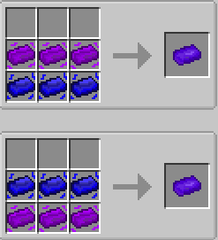
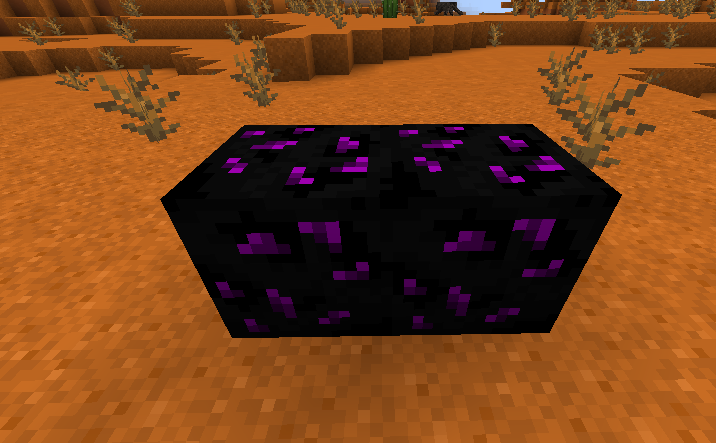

# Progressão e materiais

[English](../en/progression.md)

## O caminho pelo mod

### Tiers

```text
Tier 0:
    → Recursos vanilla, componentes de silício, máquinas Basic
Tier 1:
    → Unstable, Stable, Void, Stellar
Tier 2:
    → Duality
Tier 3:
    → Darklight
Tier 4:
    → Nova
Tier 5:
    → Zenith
Tier 6:
    → Chaos
```

## Duality


Para alcançar o tier duality, basta juntar **Unstable Bar** e **Stable Bar**

## Darklight

Uma vez que o tier duality for alcançado, você deverá fabricar uma **Duality Pickaxe**, após isso,
você deverá encontrar o **Darklight Ore** e quebrá-lo com essa picareta, adquirindo, assim, **Darklight fragment**



## Nova

Aqui o consumo de material escala muito. Primeiramente, construa a **Matter Inversion Chamber** para inverter **Stellar Liquid** e **Darklight Liquid** em **Antimatter**.

Em seguida, monte a **Event Horizon Forge**. Utilize-a para condensar Antimatéria em um **Black Hole** (Singularity Condensation) e, a partir do Black Hole, transmute **Darklight Bars** em **Nova Fragments** (Event Horizon Transmutation).

## Zenith

Para alcançar o tier **Zenith** você deve adquirir **Exotic Dust**, e adquirir **Zenith Shard**, que é um 
drop do **Zenith Crystal Block**, esse bloco só aparece em meteoros. Com isso, você será capaz de fabricar o **Zenith**

## Chaos

Para conseguir o tier **Chaos**, você já deverá ter um **Gateway** para alcançar as realidades. Após isso,
você deve fabricar **Reality Core** vazios, além de ter uma **Reality Extractor**.

Com isso, você entrar em uma realidade, colocar a **Reality Extractor**, colocar um **Reality Core** como input,
e fornecer energia. Com isso, você irá extrair o núcleo daquela realidade. Para encher um **Reality Core**, você deve
extrair 3 realidades do mesmo tipo.

Após isso, você deverá fabricar o **Chaotic Catalyst** e usá-lo em um **Gateway**. Após isso ele passará a mostrar
realidades do tipo **Chaos**, lá você poderár matar criaturas do tier **Chaos** e extrair núcleos de realidade do tipo **Chaos**.


**Próximo passo:** [máquinas](machines.md), [Gateway](gateway.md) ou a [coleta dos Reality Cores](extractor.md).
