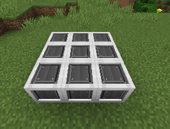
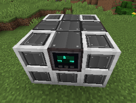
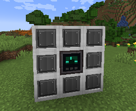

# Nova Reactor

[English](../en/reactor.md)

O Nova Reactor transforma Blackholes em calor e converte o calor armazenado em FE. Colunas de combustível, contato com coolant, circulação, temperatura e resíduos determinam a produção. O reator não exige calibração e não sofre penalidade por calibração.

## Reator compacto 3×3×3

A versão compacta original continua funcionando. Monte uma casca de casing ao redor de um **Nova Reactor Core**, exatamente no centro. Substitua posições centrais das faces por um **Controller** e pelas **Item Ports**, **Energy Ports** ou **Waste Fluid Ports** necessárias. As posições podem ser permutadas e todas as portas compartilham as mesmas reservas. Arestas e vértices continuam sendo **Nova Reactor Casing**.

```text
Topo / base        Meio, exemplo
C C C              C E C
C C C              I R I
C C C              C T C

C = Nova Reactor Casing     R = Reactor Core
T = Controller         E = Energy Port
I = Item Port
```





A versão compacta possui combustível, controle e resfriamento integrados: o Core ocupa sua única posição interna. O pico nominal é **16 MFE/t** e o buffer comporta **10 GFE**.

## Reatores maiores

Monte uma **casca cúbica de lado ímpar**, como 5×5×5, 7×7×7, 13×13×13, 17×17×17 ou maior. Não existe dimensão máxima definida pelo mod; o cubo inteiro deve caber na altura de construção do mundo.

1. Feche a superfície externa com **Nova Reactor Casing** e coloque exatamente um **Nova Reactor Core** no centro do cubo.
2. Substitua uma posição de face externa por um **Controller**, sem usar arestas ou vértices. Controller e portas podem ocupar paredes, teto ou base.
3. No interior, monte colunas verticais separadas de **Nova Fuel Rod**. Cada coluna deve atravessar todas as camadas internas, da base ao teto. Não use a coluna horizontal do Core central nem coloque colunas de combustível imediatamente lado a lado.
4. No teto, substitua o casing diretamente acima de cada coluna por um **Nova Control Rod**. Cada coluna exige seu próprio controle; controles extras sem coluna invalidam a montagem.
5. Preencha todas as posições internas restantes com **Nova Coolant Channels**, exceto o Core central. Espaços vazios invalidam a versão modular atual.
6. Adicione **Item Ports** de entrada para combustível, coolant e circulação, Item Ports de saída para processamento interno de resíduos e **Energy Ports** com cabos suficientes para distribuir a produção.

Cada Item Port de entrada fornece até oito unidades de capacidade de refrigeração. O contato local entre combustível e coolant e a distribuição próxima importam: volume refrigerante distante não garante resfriamento eficiente. Mais colunas exigem maior circulação e abastecimento.

A validação de estruturas grandes é dividida entre vários ticks. A aba Structure mostra o progresso e diferencia validação, construção inválida e chunks descarregados. Todos os chunks necessários devem permanecer carregados normalmente; o reator não força seu carregamento. Os recursos são preservados quando uma parte está descarregada.

## Produção e armazenamento

Os valores históricos de armazenamento foram mantidos:

| Lado externo | Unidades de armazenamento | Buffer de FE |
|---|---:|---:|
| 3 | 1 | 10 GFE |
| 5 | 3 | 30 GFE |
| 7 | 7 | 70 GFE |
| 9 | 14 | 140 GFE |
| 11 | 25 | 250 GFE |
| 13 | 40 | 400 GFE |

Acima do lado 13, as unidades seguem o volume interno útil: `round(40 × (lado − 2)³ / 1331)`. Cada unidade oferece **10 GFE**, **1.000.000 de combustível**, **1.000.000 de coolant** e **100.000 mB de waste**. Reduzir a estrutura preserva o conteúdo excedente; novas inserções aguardam a remoção ou o consumo desse excesso.

Até o lado 13, cada coluna completa e controlada fornece **16 MFE/t** de potência nominal. Acima dessa referência, a potência nominal acompanha os segmentos ativos de combustível, a **16/11 MFE/t por segmento**. Todas as colunas válidas da montagem atual participam; o Core não impõe o antigo limite fixo de colunas.

A potência configurada escala combustível ativo, consumo e produção de resíduos juntos. A geração efetiva também depende da temperatura do casing, eficiência espacial de refrigeração, ocupação de waste e calor residual. Uma casca maior oferece espaço e armazenamento, sem multiplicador gratuito de produção. Cada Energy Port conectada exporta conforme o throughput de seu cabo ou receptor, retirando FE de uma única reserva compartilhada.

## Combustível, coolant e resíduos

| Recurso | Função | Valor |
|---|---|---:|
| Blackhole | Combustível recebido por Item Port de entrada | 10.000 unidades/item |
| Nova Bar | Coolant recebido por Item Port de entrada | 5.000 unidades/item |
| Exotic Dust | Resultado do processamento interno | 5.000 mB waste/item |

Em potência máxima, cada equivalente de coluna efetivo consome **20 unidades de combustível/t** e produz **10 mB de waste/t**. Acima do lado 13, um equivalente corresponde a onze segmentos ativos. O gasto de coolant depende da temperatura e da circulação efetiva. Waste cheio interrompe novas reações; o calor acumulado continua perigoso.

Use o Configurator para escolher entrada/saída das Item Ports e configurar as conexões de itens e energia existentes. Não há uma tela separada de I/O do reator.

### Processamento externo de waste

Na aba Resources, escolha:

- **Internal Processing:** Item Ports de saída convertem 5.000 mB de waste em uma Exotic Dust. A extração de fluido fica desabilitada.
- **External Extraction:** a nova **Nova Reactor Waste Fluid Port** disponibiliza waste aos Fluid Cables. A conversão interna em dust fica desabilitada.

Os dois modos usam a mesma reserva. A troca não apaga waste nem restaura material já extraído. Conecte `Waste Fluid Port → Fluid Cables → Waste Tower` para alimentar um [Nova Waste Reprocessor](nova-waste-reprocessor.md), que converte **10.000 mB em 8 Exotic Dust** por padrão.

## Temperatura e segurança

A temperatura ideal do casing é **25.000 K**. Acompanhe Core Heat, Casing Heat, Passive Dissipation, Net Heat, Thermal Trend e Cooling Utilization. Overview também mostra energia armazenada/capacidade, geração efetiva, exportação e eficiência; Structure mostra colunas e segmentos ativos.

**SCRAM** interrompe a reação imediatamente, enquanto resfriamento e calor residual continuam. O SCRAM automático vem configurado para **42.000 K**; o reinício exige as duas temperaturas abaixo de **35.000 K**. Use [regras do Controller](controller.md) para condições adicionais de combustível, coolant, temperatura e waste. A estabilidade do reator é térmica: não existe uma porcentagem independente de estabilidade recuperada com Flux Crystal.

!!! danger "Meltdown"
    A partir de **45.000 K no Core**, o reator pode sofrer um meltdown destrutivo. O dano ao terreno acompanha o tamanho e é distribuído entre vários ticks. Nunca use essa temperatura como alvo normal de desligamento. Interromper a reação não elimina imediatamente o calor acumulado.

Mantenha circulação de coolant, remoção de resíduos e saída de energia durante o desligamento. Layouts internos legados preservam suas regras até a construção ser alterada, mas todo reator formado exige agora a carcaça dedicada de Nova Reactor Casing.

## Estrutura e partida segura

A carcaça exige **Nova Reactor Casing** (oito Machine Casings ao redor de uma Nova Bar produzem oito Casings). Machine Casing comum não é aceito, inclusive em layouts antigos salvos. Os blocos e recursos armazenados são preservados; substitua os blocos incorretos da carcaça para retomar a operação. O ID registrado continua `nova_reactor_chamber` para preservar os saves.

O reator só liga com combustível no reservatório interno. O botão Start fica desativado enquanto vazio, e a validação no servidor também protege o Machine Controller e as ações de rede. O resfriamento e o calor residual continuam após desligar. Use o Configurator na Item Port para alternar Entrada/Saída; modelos em ciano/verde e âmbar mostram o modo atual. O dado antigo `isInput` preserva esse modo no save.

## Nova Reactor Glass e interfaces externas

O **Nova Reactor Glass** pode substituir casing em qualquer face externa plana, inclusive teto e fundação. Controller e ports seguem a mesma regra: não precisam ficar no centro da face. Arestas e vértices exigem Nova Reactor Casing. Mantenha os Control Rods obrigatórios no teto acima das colunas de combustível ativas. O vidro permite a passagem normal de luz e não escurece o interior. Uma unidade de qualquer vidro cercada por quatro Nova Reactor Casings em cruz produz quatro vidros do reator.
